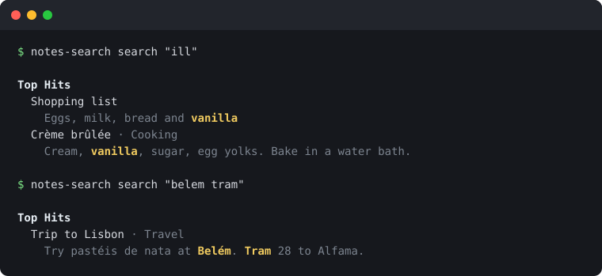
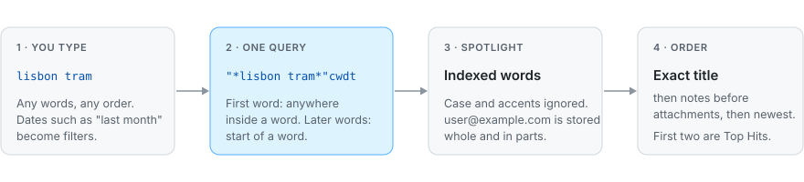

# notes-search

[](https://github.com/FL-spec/notes-search/actions/workflows/ci.yml)
[](https://github.com/FL-spec/notes-search/releases)
[](pyproject.toml)
[](pyproject.toml)
[](LICENSE)

Search your notes and text files exactly the way Apple Notes does.

**[Install](#install) · [Quick start](#quick-start) · [How it works](docs/how-it-works.md) · [Accuracy](docs/validation.md) · [FAQ](#faq)**

<p align="center">
  
</p>

notes-search reproduces the search behaviour of Apple Notes on macOS: which notes match, in what
order, and which two become Top Hits. It was built by reverse engineering Notes and Spotlight,
then checked against both, search by search. It's a small Python package with no dependencies.

## Highlights

- **The same results as Notes.** 54 of 54 searches matched Notes.app on a real library, and 414 of
  417 matched Spotlight on a corpus written to break it. [How this was tested](docs/validation.md).
- **The rules, written down.** [docs/how-it-works.md](docs/how-it-works.md) explains every
  matching, ordering and tokenization rule, and [docs/reverse-engineering.md](docs/reverse-engineering.md)
  names the Apple symbols behind them.
- **Your notes, or any text.** Index Apple Notes, folders of Markdown and text files, or JSON, and
  search them together.
- **The features Apple left switched off.** Notes contains a typo-tolerant search, spell-checker
  expansion and related-word queries that the app never enables. They're here as opt-in flags.
- **Local and private.** Nothing leaves your Mac. See the [security policy](SECURITY.md).

## Install

Requires Python 3.10 or later. The Apple Notes import and the Spotlight commands need macOS;
everything else runs anywhere.

```bash
pipx install git+https://github.com/FL-spec/notes-search
```

Or with pip, from a clone of this repository:

```bash
pip install .
```

## Quick start

Try it on the sample notes that come with the repository:

```bash
notes-search search "ill" --source examples/notes
```

Index your own notes once, then search as often as you like:

```bash
notes-search index apple-notes ~/Documents/notes
notes-search search "lisbon tram"
```

The first time you index `apple-notes`, macOS asks for permission to let your terminal control
Notes. Locked notes are indexed by title only, which is what Notes itself does.

## How Notes search works

<p align="center">
  
</p>

1. **One query from the whole search.** Notes wraps what you typed in wildcards and sends it to
   Spotlight as `"*lisbon tram*"cwdt`, ignoring case and accents.
2. **The first word matches anywhere inside a word; later words match the start of one.** `ill`
   finds *vanilla*. `orvat release` finds *Quorvatix … release*, but `release orvat` doesn't.
3. **Words can come from anywhere in the note,** title included, in any order.
4. **Punctuation follows Spotlight's index.** `user@example.com`, `alpha-beta`, URLs and numbers
   are stored whole and in parts, so `example.com` and `beta` both find them.
5. **Typos aren't corrected.** Notes asks the spell checker for guesses, but they never add results.
6. **Newest first.** An exact title match leads, then notes come before attachments, then the most
   recently edited. The first two results are the Top Hits.
7. **Dates are filters.** "last month" means since the 1st of the previous month.

The [full explanation](docs/how-it-works.md) covers each rule, with examples.

## Usage

### Building an index

```bash
notes-search index apple-notes
notes-search index ~/Documents/notes backup.json
```

Sources are folders of `.md`, `.txt`, `.org` or `.rst` files, JSON files, or `apple-notes`, and
several can go into one index. In folders, the first non-empty line of a file is its title.

The index lives at `~/.notes-search/index.json`, or wherever `--index` or `NOTES_SEARCH_INDEX`
points. It contains the full text of everything you indexed.

### Searching

```bash
notes-search search "budget last month"
notes-search search "milk" --has checklists
notes-search search "taxes" --verbose
notes-search search "taxes" --json
notes-search interactive
```

| Option | Effect |
| --- | --- |
| `--has NAME` | Only notes with an attribute, like the filter chips in Notes: `attachments`, `checklists`, `drawings`, `scans`, `tags`, `locked`, `shared`. Repeatable, and works without search text. |
| `--strategy 0\|1\|2` | Sort order. `0` is what Notes uses; `1` sorts by relevance score, `2` by age bucket then score. |
| `--explain` | Print the Spotlight queries Notes would run. |
| `--verbose` | Show which query found each result, its score and which fields matched. |
| `--source PATH` | Search a folder or file directly instead of the index. Repeatable. |
| `--no-nl` | Treat date phrases, `folder:` and `#tags` as plain text. |
| `--json`, `--limit N` | Machine-readable output; number of results. |

Features that exist in Notes but are switched off in the app:

| Option | Feature |
| --- | --- |
| `--fuzzy` | Typo tolerance using Spotlight's own fuzzy matcher, plus a per-word substring pass |
| `--spell` | Add the system spell checker's guesses for misspelled words |
| `--spell-api` | Extra queries for the spell checker's first guess and the word's dictionary form |
| `--related` | Extra queries for related words from Apple's word embeddings |

### Spotlight commands

`query` prints the query Notes would build. `spotlight` runs that query against files on your Mac
through `mdfind`, so you can search ordinary documents with Notes' rules.

```bash
notes-search query "lisbon tram"
notes-search spotlight "invoice march" --onlyin ~/Documents
```

## Using it as a library

```python
from notes_search.engine import SearchEngine
from notes_search.sources import from_folder

engine = SearchEngine(from_folder("~/notes"))

for result in engine.search("lisbon tram"):
    print(result.item.title, result.is_top_hit, result.ranking_score)
```

`search` returns results in Notes' order. `sections` groups them into Top Hits, Notes and
Attachments, and `search_batched` yields them in batches the way the Notes list fills in. To
search notes stored somewhere else, build `notes_search.sources.Document` objects yourself.

## Accuracy

| Test | Result |
| --- | --- |
| Notes.app, real 17-note library | 54 / 54 searches identical: same notes, order and Top Hits |
| Spotlight, synthetic corpus (accents, ß, URLs, emails, camelCase, emoji, Japanese, apostrophes) | 414 / 417 queries identical, including 71 never used to change the code |
| Spotlight's fuzzy matcher, 295 typo variants at four thresholds | no match Spotlight accepts is rejected |

[docs/validation.md](docs/validation.md) has the method and every remaining difference. The
corpus and queries are in [`scripts/lab`](scripts/lab), so you can rerun the comparison on your Mac.

## FAQ

**Does it read the Notes database directly?**
No. It asks Notes for your notes through Apple's automation interface, the way a script would, so
it needs no special access and never opens Notes' files.

**Why not just use Spotlight or `mdfind`?**
They only search what Spotlight has indexed on your Mac, and they don't order results or pick Top
Hits the way Notes does. notes-search applies Notes' whole pipeline to any text you give it.

**Why doesn't it correct my typos?**
Because Notes doesn't. If you want typo tolerance anyway, `--fuzzy` turns on the matcher Apple
built but never switched on.

**Does it work on Linux or Windows?**
Searching folders and JSON does. Importing Apple Notes and the Spotlight commands need macOS.

**Is this affiliated with Apple?**
No. See [License](#license).

## Limitations

- **Natural language.** Notes parses phrases like "photos from last summer" with a private Apple
  parser. notes-search understands the date phrases that were measured, plus `folder:` and
  `#tags`, but not Apple's full grammar.
- **Attachment kinds.** Drawings and scanned documents can't be told apart through Notes'
  automation interface, so `--has drawings` and `--has scans` only work for sources that set them.
- **Photo recognition.** Notes also searches labels from on-device image recognition.
  notes-search searches those labels when a source provides them, but doesn't generate them.
- **Spotlight quirks.** A few edge cases differ, such as fragments starting at an inner apostrophe
  (`n'roll` in *rock'n'roll*). They're listed in [validation.md](docs/validation.md).
- **One version.** Everything was measured on macOS 26. Apple can change search in any release.

## Contributing

Bug reports, mismatches with Notes.app and pull requests are welcome. Matching and ordering rules
came from measurements, so a change to them needs a measurement too:
[CONTRIBUTING.md](CONTRIBUTING.md) explains what that means in practice. Please follow the
[code of conduct](CODE_OF_CONDUCT.md).

```bash
python3 -m unittest discover -s tests            # unit tests, any platform
python3 scripts/matching_lab.py fuzzylab/corpus  # compare with Spotlight, macOS only
```

## License

[MIT](LICENSE).

notes-search is an independent project, not affiliated with or endorsed by Apple. It contains no
Apple code: the behaviour was worked out by studying and observing the shipped software, and this
is a fresh implementation. Apple and Apple Notes are trademarks of Apple Inc.
